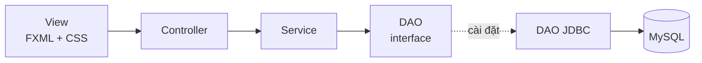
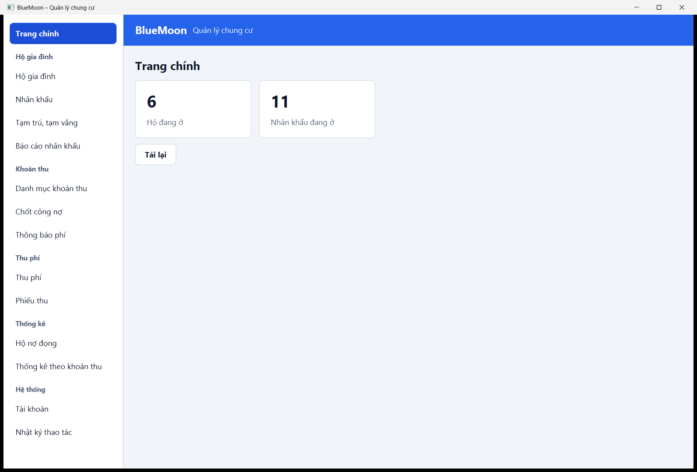

# Kiến trúc mã nguồn

Ứng dụng máy tính để bàn JavaFX, mọi máy dùng chung một CSDL MySQL
(TS-003). Tài liệu này mô tả cách chia tầng và cách thêm một màn hình, để
cả nhóm viết theo cùng một kiểu. Mẫu đầy đủ là **trang chính** (số hộ và
số nhân khẩu đang ở).

## 1. Các tầng

| Tầng | Gói / thư mục | Việc | Mẫu |
|---|---|---|---|
| View | `resources/com/bluemoon/view/` | Bố cục màn hình, không có logic | `trang-chinh.fxml` |
| Controller | `com.bluemoon.controller` | Nhận sự kiện, gọi Service, hiện kết quả hoặc câu báo lỗi | `TrangChinhController` |
| Service | `com.bluemoon.service` | Quy tắc nghiệp vụ, kiểm tra dữ liệu | `CuDanService` |
| DAO | `com.bluemoon.dao` | Đọc, ghi CSDL bằng SQL | `CuDanDao`, `CuDanDaoJdbc` |
| Model | `com.bluemoon.model` | Lớp dữ liệu truyền giữa các tầng | `SoLieuCuDan` |
| Dùng chung | `com.bluemoon.config`, `com.bluemoon.util` | Kết nối CSDL, điều hướng màn hình | `KetNoiCsdl`, `DieuHuong`, `ManHinh` |

Quy tắc:

- **Mỗi tầng chỉ gọi tầng ngay dưới.** Controller không gọi DAO, không
  viết SQL; Service không đụng tới JavaFX.
- Service nhận DAO qua constructor và chỉ biết **interface** DAO, nên test
  Service bằng DAO giả, không cần MySQL.
- Controller tạo Service với bản JDBC của DAO
  (`new CuDanService(new CuDanDaoJdbc())`).
- Kiểu chữ, màu, nút chỉ khai báo trong `css/giao-dien.css`, theo
  [ui.md](ui.md); FXML dùng `styleClass`, không viết màu thẳng vào màn.

## 2. Khởi động

`Launcher` → `App`: nạp phông Be Vietnam Pro, thử kết nối CSDL
(AC-070), rồi mở màn đăng nhập `dang-nhap.fxml` (US-021). Không kết nối
được thì hiện hộp thoại nói nguyên nhân, cách sửa và thoát.

`CuaSoUngDung` chuyển cửa sổ giữa màn đăng nhập và `cua-so-chinh.fxml`.
Đăng nhập đúng thì `DangNhapService` ghi người dùng vào `PhienDangNhap`
rồi mở cửa sổ chính; Đăng xuất xóa phiên và về màn đăng nhập.

Cửa sổ chính có bố cục trái – đầu – thân: menu trái dựng từ `ManHinh`,
thanh đầu có tên ứng dụng, họ tên và vai trò người đăng nhập, nút Đăng
xuất; vùng thân do `DieuHuong` nạp màn hình. `DieuHuong` chặn mọi màn
hình khi chưa đăng nhập (AC-059), nên màn hình mới không cần tự kiểm tra.
Cần biết ai đang dùng (vd ghi người thu, phân quyền US-022) thì lấy
`PhienDangNhap.nguoiDung()`. Bố cục và màu sẽ chỉnh theo thiết kế Figma
(#70).

## 3. Đặt tên

Theo [quy ước mã](coding-convention.md): tên lớp, phương thức, biến bằng
tiếng Việt không dấu (`KetNoiCsdl`, `demDangO`).

| Loại | Quy ước | Ví dụ |
|---|---|---|
| DAO | Interface `<Ten>Dao`, bản JDBC `<Ten>DaoJdbc` | `CuDanDao`, `CuDanDaoJdbc` |
| Service | `<Ten>Service` | `CuDanService` |
| Controller | `<TenManHinh>Controller` | `TrangChinhController` |
| FXML | Chữ thường, gạch nối, cùng tên màn hình | `trang-chinh.fxml` |
| Kiểu CSS | Chữ thường, gạch nối | `the-so-lieu`, `thong-bao-loi` |
| Test đơn vị | `<Lop>Test`, chạy trong `mvn verify` | `CuDanServiceTest` |
| DAO giả | `<Ten>DaoGia`, đặt trong test | `CuDanDaoGia` |
| Kiểm thử tích hợp | `<Lop>IT`, chỉ chạy với `-Pmysql` | `CuDanDaoJdbcIT` |

## 4. Xử lý lỗi

- DAO bắt `SQLException` và ném `LoiCsdl.tu(e)`. `LoiCsdl` là lỗi chung
  cho mọi DAO: `getMessage()` là câu báo tiếng Việt nói rõ cần làm gì
  (thiếu cấu hình, MySQL chưa chạy, sai mật khẩu, chưa cấp quyền, chưa
  dựng CSDL), lỗi gốc giữ trong `getCause()`.
- Service để `LoiCsdl` đi lên nguyên vẹn.
- Controller bắt `LoiCsdl`, hiện `getMessage()` ở nhãn `thong-bao-loi`.
  Nhãn này đặt `managed` theo `visible` để chỉ chiếm chỗ khi có chữ.
- Không in stack trace, không hiện mã lỗi hay chữ tiếng Anh của hệ thống
  cho người dùng.

## 5. Thêm một màn hình mới trong 6 bước

Ví dụ: màn hình hộ gia đình (US-001). Làm theo đúng mẫu trang chính.

1. **DAO:** interface `HoGiaDinhDao` và bản `HoGiaDinhDaoJdbc` trong
   `com.bluemoon.dao`. Mỗi phương thức mở kết nối từ `NguonKetNoi`, dùng
   `PreparedStatement` trong try-with-resources, bắt `SQLException` rồi
   ném `LoiCsdl.tu(e)` (xem `CuDanDaoJdbc`).
2. **Service:** `HoGiaDinhService` trong `com.bluemoon.service`, nhận
   `HoGiaDinhDao` qua constructor; đặt quy tắc nghiệp vụ ở đây (xem
   `CuDanService`).
3. **Test:** `HoGiaDinhServiceTest` dùng DAO giả cho từng quy tắc (xem
   `CuDanServiceTest`); câu SQL khó thì thêm `HoGiaDinhDaoJdbcIT` chạy trên
   MySQL thật (xem `CuDanDaoJdbcIT`).
4. **View:** `ho-gia-dinh.fxml` trong `resources/com/bluemoon/view/`, gốc
   là `VBox` có `styleClass="trang"`, dùng các kiểu sẵn có (`tieu-de-trang`,
   `nut-chinh`, `thong-bao-loi`…).
5. **Controller:** `HoGiaDinhController` trong `com.bluemoon.controller`:
   tạo Service với bản JDBC, nạp dữ liệu trong `initialize()`, bắt
   `LoiCsdl` và hiện câu báo (xem `TrangChinhController`).
6. **Đăng ký:** trong `ManHinh`, ghi tên tệp vào dòng của màn hình:
   `HO_GIA_DINH("Hộ gia đình", NhomMenu.HO_GIA_DINH, "ho-gia-dinh.fxml")`.
   Menu trái tự mở màn hình mới thay cho trang "đang được xây dựng".

Chạy `mvn verify` trước khi mở Pull Request; `ManHinhTest` báo lỗi nếu
ghi tên tệp FXML không có thật.

## 6. Kiểm thử tích hợp

Lớp `*IT` chạy bằng `mvn verify -Pmysql` (job `build-mysql` của CI), trên
CSDL có chữ `test` trong tên. `CsdlKiemThu` xóa và tạo lại bảng theo
`database/schema.sql` trước mỗi test, nên test không phụ thuộc dữ liệu cũ.
Cách đặt biến môi trường: [setup.md](../setup.md), mục 4.
