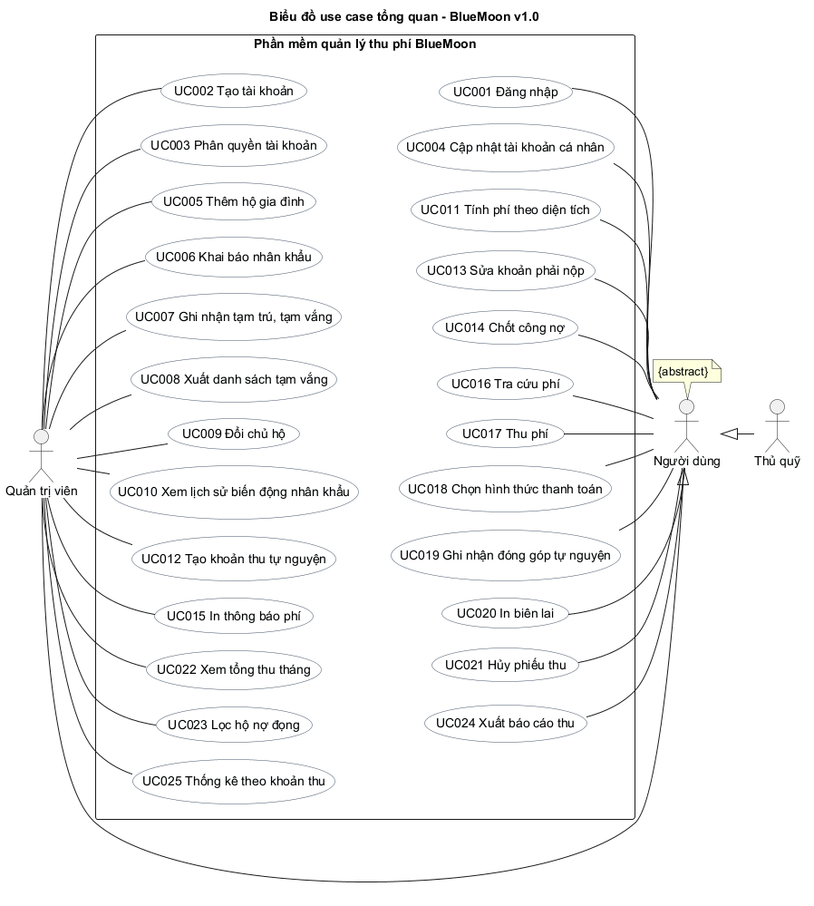
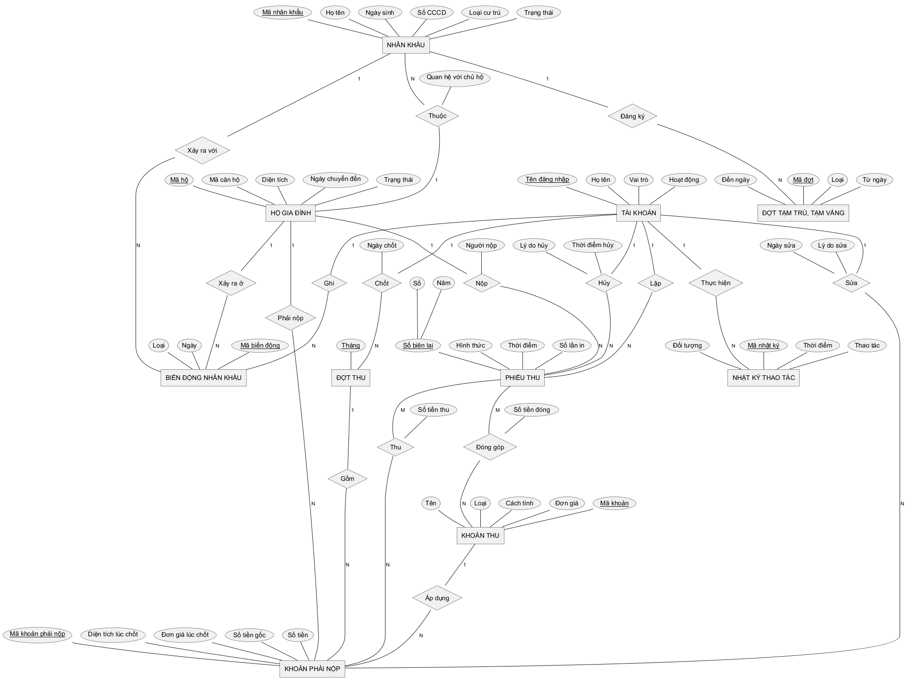
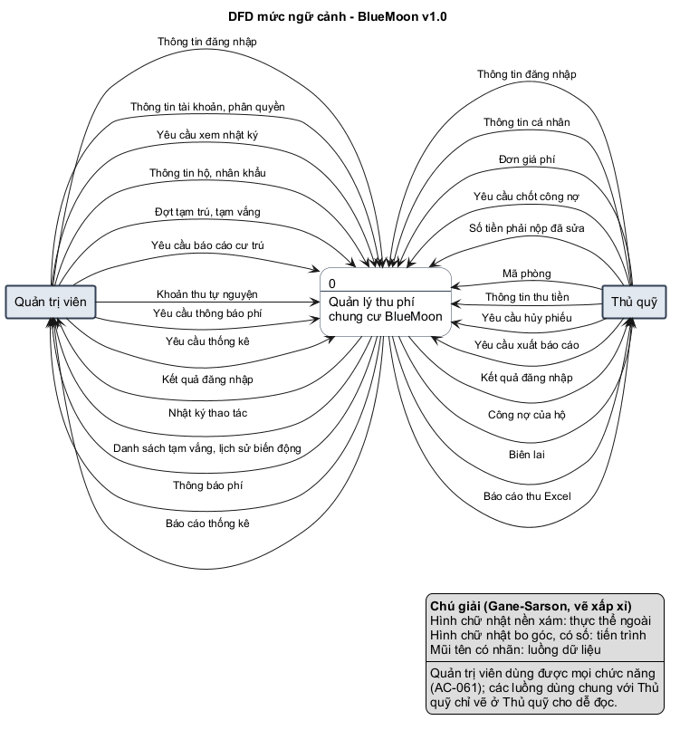
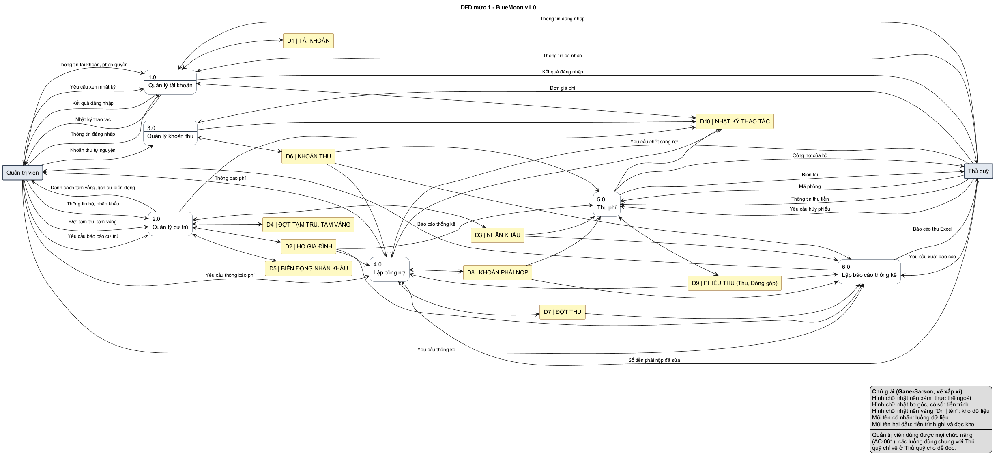
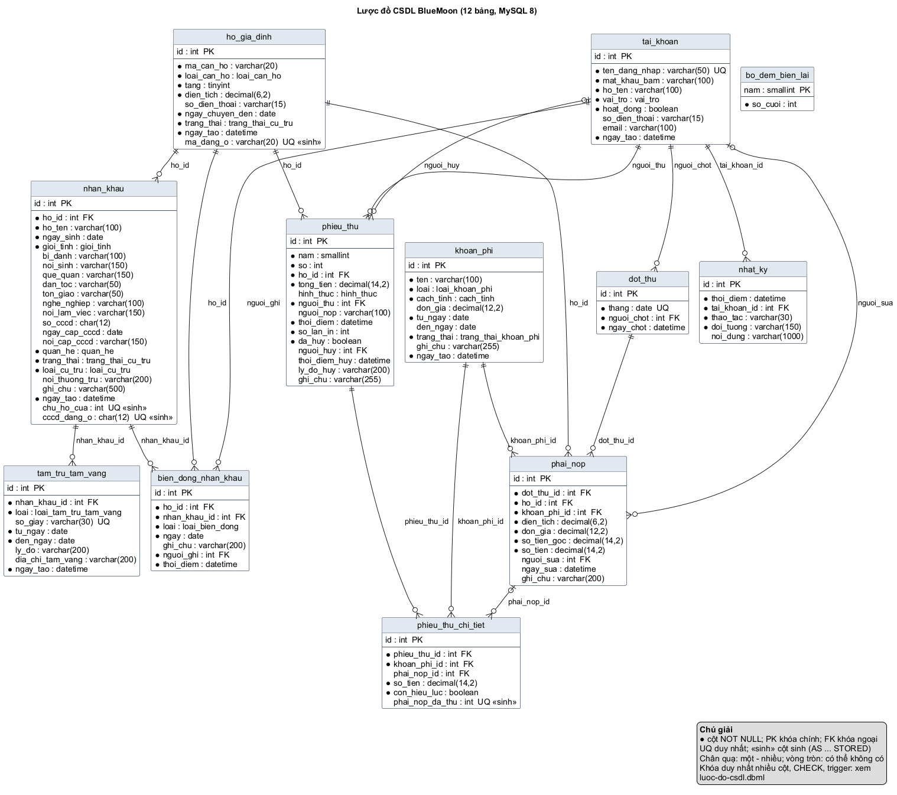
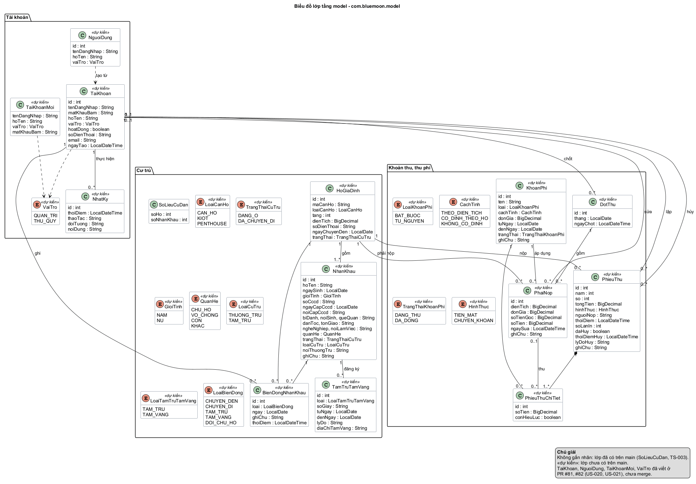

# Sơ đồ tổng thể

Các sơ đồ mô hình hoá yêu cầu và thiết kế của BlueMoon v1.0, viết bằng văn
bản (PlantUML, DBML). Nguồn: [user story](../../requirements/07-user-stories.md),
[Epic/Feature](../../requirements/06-epic-feature-list.md),
[chốt và giả định](../../requirements/11-chot-va-gia-dinh.md),
[schema.sql](../../../database/schema.sql), [kiến trúc](../kien-truc.md),
[thuật ngữ](../../thuat-ngu.md) và mã nguồn trong `src/`.

**Mã UC và tên thực thể ở tệp này là mã chung cho cả nhóm.** Sơ đồ của thành
viên dùng đúng các mã, tên này; cần thêm hoặc đổi thì báo TV1 sửa tệp này
trước.

## 1. Danh sách sơ đồ

| Sơ đồ | Tệp nguồn | Ảnh | Người phụ trách |
|---|---|---|---|
| Use case tổng quan | [use-case-tong-quan.puml](use-case-tong-quan.puml) | [use-case-tong-quan.png](use-case-tong-quan.png) | TV1 Khánh |
| ERD khái niệm (Chen) | [erd-khai-niem.puml](erd-khai-niem.puml) | [erd-khai-niem.png](erd-khai-niem.png) | TV1 Khánh |
| Lược đồ CSDL (12 bảng) | [luoc-do-csdl.dbml](luoc-do-csdl.dbml), [luoc-do-csdl.puml](luoc-do-csdl.puml) | [luoc-do-csdl.png](luoc-do-csdl.png) | TV1 Khánh |
| DFD mức ngữ cảnh | [dfd-ngu-canh.puml](dfd-ngu-canh.puml) | [dfd-ngu-canh.png](dfd-ngu-canh.png) | TV1 Khánh |
| DFD mức 1 | [dfd-muc-1.puml](dfd-muc-1.puml) | [dfd-muc-1.png](dfd-muc-1.png) | TV1 Khánh |
| Biểu đồ lớp tầng model | [bieu-do-lop-model.puml](bieu-do-lop-model.puml) | [bieu-do-lop-model.png](bieu-do-lop-model.png) | TV1 Khánh |

**Xuất ảnh.** Tải `plantuml.jar` từ
[trang phát hành PlantUML](https://github.com/plantuml/plantuml/releases) về
một thư mục ngoài repo (không commit), rồi ở thư mục gốc repo chạy:

```bash
java -jar <đường-dẫn>/plantuml.jar -charset UTF-8 -nometadata -tpng docs/design/so-do/*.puml
```

Ảnh `.png` ra cạnh tệp nguồn, cùng tên; commit cả ảnh để chèn báo cáo. Các
sơ đồ dùng `!pragma layout smetana` nên không cần cài Graphviz. Lược đồ DBML
xem trực tiếp bằng cách dán `luoc-do-csdl.dbml` vào
[dbdiagram.io](https://dbdiagram.io); ảnh lấy từ `luoc-do-csdl.puml` (cùng
nội dung, ký pháp IE). Sửa `schema.sql` thì sửa cả hai tệp lược đồ.

## 2. Use case (mã chung)



**Tác nhân.** "Người dùng" là tác nhân trừu tượng; "Quản trị viên" và "Thủ
quỹ" kế thừa nó. UC ghi "Người dùng" là chức năng chung cả hai vai trò dùng;
UC ghi "Quản trị viên" chỉ Quản trị viên dùng (Quản trị viên dùng được mọi
chức năng, AC-061). Cư dân, công an phường không dùng phần mềm nên không phải
tác nhân (giả định 2 trong tệp 11).

**Tiền điều kiện chung.** Mọi UC trừ UC001 có tiền điều kiện "Người dùng đã
đăng nhập"; sơ đồ không vẽ `<<include>>` Đăng nhập.

Mỗi UC ứng một user story v1.0 (US-024, US-025 thuộc v2.0, không vẽ).

| Mã UC | Tên | Tác nhân | US nguồn | Nhóm |
|---|---|---|---|---|
| UC001 | Đăng nhập | Người dùng | US-021 | Tài khoản |
| UC002 | Tạo tài khoản | Quản trị viên | US-020 | Tài khoản |
| UC003 | Phân quyền tài khoản | Quản trị viên | US-022 | Tài khoản |
| UC004 | Cập nhật tài khoản cá nhân | Người dùng | US-023 | Tài khoản |
| UC005 | Thêm hộ gia đình | Quản trị viên | US-001 | Cư trú |
| UC006 | Khai báo nhân khẩu | Quản trị viên | US-002 | Cư trú |
| UC007 | Ghi nhận tạm trú, tạm vắng | Quản trị viên | US-003 | Cư trú |
| UC008 | Xuất danh sách tạm vắng | Quản trị viên | US-004 | Cư trú |
| UC009 | Đổi chủ hộ | Quản trị viên | US-026 | Cư trú |
| UC010 | Xem lịch sử biến động nhân khẩu | Quản trị viên | US-027 | Cư trú |
| UC011 | Tính phí theo diện tích | Người dùng | US-005 | Khoản thu |
| UC012 | Tạo khoản thu tự nguyện | Quản trị viên | US-006 | Khoản thu |
| UC013 | Sửa khoản phải nộp | Người dùng | US-008 | Khoản thu |
| UC014 | Chốt công nợ | Người dùng | US-009 | Khoản thu |
| UC015 | In thông báo phí | Quản trị viên | US-015 | Khoản thu |
| UC016 | Tra cứu phí | Người dùng | US-010 | Thu phí |
| UC017 | Thu phí | Người dùng | US-011 | Thu phí |
| UC018 | Chọn hình thức thanh toán | Người dùng | US-012 | Thu phí |
| UC019 | Ghi nhận đóng góp tự nguyện | Người dùng | US-007 | Thu phí |
| UC020 | In biên lai | Người dùng | US-013 | Thu phí |
| UC021 | Hủy phiếu thu | Người dùng | US-014 | Thu phí |
| UC022 | Xem tổng thu tháng | Quản trị viên | US-016 | Thống kê |
| UC023 | Lọc hộ nợ đọng | Quản trị viên | US-017 | Thống kê |
| UC024 | Xuất báo cáo thu | Người dùng | US-018 | Thống kê |
| UC025 | Thống kê theo khoản thu | Quản trị viên | US-019 | Thống kê |

## 3. ERD khái niệm (tên thực thể chung)



Sơ đồ chỉ vẽ thuộc tính khóa, thuộc tính chính và mọi thuộc tính của quan
hệ; bảng dưới liệt kê đủ. Không vẽ giá trị tính được (tổng tiền phiếu thu,
công nợ, số tháng nợ, "đang tạm trú/tạm vắng" tính theo ngày).

| Thực thể | Thuộc tính (khóa in đậm) | Bảng |
|---|---|---|
| TÀI KHOẢN | **Tên đăng nhập**, Mật khẩu (đã băm), Họ tên, Vai trò, Hoạt động, Số điện thoại, Email, Ngày tạo | `tai_khoan` |
| HỘ GIA ĐÌNH | **Mã hộ**, Mã căn hộ, Loại căn hộ, Tầng, Diện tích, Số điện thoại, Ngày chuyển đến, Trạng thái | `ho_gia_dinh` |
| NHÂN KHẨU | **Mã nhân khẩu**, Họ tên, Ngày sinh, Giới tính, Số CCCD, Ngày cấp, Nơi cấp, Lý lịch bổ sung (bí danh, nơi sinh, quê quán, dân tộc, tôn giáo, nghề nghiệp, nơi làm việc), Loại cư trú, Nơi thường trú, Trạng thái, Ghi chú | `nhan_khau` |
| ĐỢT TẠM TRÚ, TẠM VẮNG | **Mã đợt**, Loại, Số giấy, Từ ngày, Đến ngày, Lý do, Nơi đến | `tam_tru_tam_vang` |
| BIẾN ĐỘNG NHÂN KHẨU | **Mã biến động**, Loại, Ngày, Ghi chú, Thời điểm ghi | `bien_dong_nhan_khau` |
| KHOẢN THU | **Mã khoản**, Tên, Loại, Cách tính, Đơn giá, Từ ngày, Đến ngày, Trạng thái, Ghi chú | `khoan_phi` |
| ĐỢT THU | **Tháng** | `dot_thu` |
| KHOẢN PHẢI NỘP | **Mã khoản phải nộp**, Diện tích lúc chốt, Đơn giá lúc chốt, Số tiền gốc, Số tiền | `phai_nop` |
| PHIẾU THU | **Số biên lai** (Năm, Số), Hình thức, Thời điểm, Số lần in, Ghi chú | `phieu_thu` |
| NHẬT KÝ THAO TÁC | **Mã nhật ký**, Thời điểm, Thao tác, Đối tượng, Nội dung | `nhat_ky` |

| Quan hệ | Giữa | Bản số | Thuộc tính của quan hệ | Cột trong `schema.sql` |
|---|---|---|---|---|
| Thuộc | NHÂN KHẨU – HỘ GIA ĐÌNH | N : 1 | Quan hệ với chủ hộ | `nhan_khau.ho_id`, `.quan_he` |
| Đăng ký | NHÂN KHẨU – ĐỢT TẠM TRÚ, TẠM VẮNG | 1 : N | – | `tam_tru_tam_vang.nhan_khau_id` |
| Xảy ra với | NHÂN KHẨU – BIẾN ĐỘNG NHÂN KHẨU | 1 : N | – | `bien_dong_nhan_khau.nhan_khau_id` |
| Xảy ra ở | HỘ GIA ĐÌNH – BIẾN ĐỘNG NHÂN KHẨU | 1 : N | – | `bien_dong_nhan_khau.ho_id` |
| Ghi | TÀI KHOẢN – BIẾN ĐỘNG NHÂN KHẨU | 1 : N | – | `bien_dong_nhan_khau.nguoi_ghi` |
| Chốt | TÀI KHOẢN – ĐỢT THU | 1 : N | Ngày chốt | `dot_thu.nguoi_chot`, `.ngay_chot` |
| Gồm | ĐỢT THU – KHOẢN PHẢI NỘP | 1 : N | – | `phai_nop.dot_thu_id` |
| Phải nộp | HỘ GIA ĐÌNH – KHOẢN PHẢI NỘP | 1 : N | – | `phai_nop.ho_id` |
| Áp dụng | KHOẢN THU – KHOẢN PHẢI NỘP | 1 : N | – | `phai_nop.khoan_phi_id` |
| Sửa | TÀI KHOẢN – KHOẢN PHẢI NỘP | 1 : N | Ngày sửa, Lý do sửa | `phai_nop.nguoi_sua`, `.ngay_sua`, `.ghi_chu` |
| Nộp | HỘ GIA ĐÌNH – PHIẾU THU | 1 : N | Người nộp | `phieu_thu.ho_id`, `.nguoi_nop` |
| Lập | TÀI KHOẢN – PHIẾU THU | 1 : N | – | `phieu_thu.nguoi_thu` |
| Hủy | TÀI KHOẢN – PHIẾU THU | 1 : N | Thời điểm hủy, Lý do hủy | `phieu_thu.nguoi_huy`, `.thoi_diem_huy`, `.ly_do_huy` |
| Thu | PHIẾU THU – KHOẢN PHẢI NỘP | M : N | Số tiền thu | `phieu_thu_chi_tiet` (có `phai_nop_id`) |
| Đóng góp | PHIẾU THU – KHOẢN THU | M : N | Số tiền đóng | `phieu_thu_chi_tiet` (`phai_nop_id` trống) |
| Thực hiện | TÀI KHOẢN – NHẬT KÝ THAO TÁC | 1 : N | – | `nhat_ky.tai_khoan_id` |

Chỉ có ở mức cài đặt, không có trong ERD khái niệm: bảng `bo_dem_bien_lai`
(bộ đếm số biên lai), cột `phieu_thu.tong_tien` (giá trị tính được), cột
`phieu_thu_chi_tiet.con_hieu_luc` và các cột sinh `ma_dang_o`, `chu_ho_cua`,
`cccd_dang_o`, `phai_nop_da_thu` (phục vụ ràng buộc duy nhất).

## 4. DFD





| Tiến trình | UC tương ứng | Kho đọc, ghi |
|---|---|---|
| 1.0 Quản lý tài khoản | UC001 – UC004 | D1, D10 |
| 2.0 Quản lý cư trú | UC005 – UC010 | D2 – D5, ghi D10 |
| 3.0 Quản lý khoản thu | UC011 (đơn giá), UC012 | D6, ghi D10 |
| 4.0 Lập công nợ | UC011 (tính phí), UC013 – UC015 | đọc D2, D6, D9; D7, D8; ghi D10 |
| 5.0 Thu phí | UC016 – UC021 | đọc D2, D3, D6, D8; D9; ghi D10 |
| 6.0 Lập báo cáo thống kê | UC022 – UC025 | đọc D2, D3, D6 – D9 |

| Kho | Thực thể / quan hệ ERD |
|---|---|
| D1 | TÀI KHOẢN |
| D2 | HỘ GIA ĐÌNH |
| D3 | NHÂN KHẨU (gồm quan hệ Thuộc) |
| D4 | ĐỢT TẠM TRÚ, TẠM VẮNG |
| D5 | BIẾN ĐỘNG NHÂN KHẨU |
| D6 | KHOẢN THU |
| D7 | ĐỢT THU |
| D8 | KHOẢN PHẢI NỘP |
| D9 | PHIẾU THU (gồm quan hệ Thu, Đóng góp) |
| D10 | NHẬT KÝ THAO TÁC |

## 5. Lược đồ CSDL và biểu đồ lớp





Biểu đồ lớp: lớp đã có trên `main` không gắn nhãn (`SoLieuCuDan`); lớp chưa
có gắn «dự kiến». Tên lớp, thuộc tính theo bảng trong `schema.sql` và quy ước
đặt tên ở [kien-truc.md](../kien-truc.md) mục 3.

## 6. Sơ đồ thành viên bổ sung

| Thành viên | Sơ đồ |
|---|---|
| TV2 Dũng | Biểu đồ UC nhóm Cư trú (UC005 – UC010); đặc tả và biểu đồ hoạt động "Đổi chủ hộ" (UC009); máy trạng thái Nhân khẩu. Review ERD khái niệm và lược đồ CSDL |
| TV3 Hùng | Biểu đồ UC nhóm Khoản thu (UC011 – UC015); đặc tả và biểu đồ hoạt động "Chốt công nợ đầu tháng" (UC014); máy trạng thái Khoản phải nộp |
| TV4 Đạt | Biểu đồ UC nhóm Thu phí (UC016 – UC021); đặc tả và biểu đồ hoạt động "Thu phí" (UC017); biểu đồ tuần tự Thu phí; máy trạng thái Phiếu thu |
| TV5 Huy | Biểu đồ UC nhóm Thống kê (UC022 – UC025); đặc tả và biểu đồ hoạt động "Thống kê khoản thu" (UC025); biểu đồ tuần tự Xuất báo cáo (UC024) |

Ghi chú:

- Dùng đúng mã UC (mục 2) và tên thực thể, quan hệ (mục 3) ở trên; sự kiện
  trong máy trạng thái ghi mã UC sinh ra nó.
- Đặt tệp trong thư mục này (`docs/design/so-do/`), tệp nguồn và ảnh `.png`
  cùng tên; thêm một dòng vào bảng ở mục 1.
- Biểu đồ tuần tự đi đúng tầng View → Controller → Service → DAO theo
  [kien-truc.md](../kien-truc.md).

## Giả định

1. **Tác nhân theo story hay theo AC-060.** US-005, US-008, US-009, US-018
   viết "Là Thủ quỹ", nhưng AC-060 nói Thủ quỹ "chỉ dùng được chức năng thu
   phí và tra cứu". Sơ đồ theo story: UC011, UC013, UC014, UC024 nối với
   "Người dùng" (cả hai vai trò). Cần chốt khi làm US-022.
2. **Đổi đơn giá.** US-005 chỉ nói hệ thống tự tính; AC-016 cho "BQT có thể
   thay đổi" đơn giá. UC011 gồm cả đổi đơn giá và tính phí khi chốt; DFD tách
   phần đổi đơn giá vào 3.0, phần tính phí vào 4.0.
3. **US-021 "Là Ban quản trị"** nhưng Thủ quỹ cũng phải đăng nhập, nên UC001
   nối với "Người dùng".
4. **UC018 Chọn hình thức thanh toán** (US-012) là một phần của lần thu; giữ
   thành UC riêng vì mỗi UC ứng một story. Sơ đồ nhóm Thu phí của TV4 có thể
   nối nó với UC017 bằng `<<include>>`.
5. **Câu chuyện kỹ thuật không thành UC** (TS-001 sao lưu, TS-002 nhật ký,
   TS-003 nền tảng, TS-004 giao diện) vì không phải user story. Riêng phần
   xem nhật ký của TS-002 (AC-069) có trong DFD (tiến trình 1.0, kho D10) để
   kho nhật ký có tiến trình đọc.
6. **Quản trị viên trong DFD.** Luồng của các chức năng dùng chung chỉ vẽ ở
   Thủ quỹ cho dễ đọc; Quản trị viên cũng gửi, nhận được các luồng đó
   (AC-061). Luồng đăng nhập vẽ cho cả hai.
7. **Khoản phải nộp là thực thể** (thực thể kết hợp) chứ không phải quan hệ ba
   ngôi Hộ – Khoản thu – Đợt thu, vì nó còn tham gia quan hệ Thu và Sửa.
8. **Thu và Đóng góp là hai quan hệ** dù cùng lưu ở `phieu_thu_chi_tiet`: Thu
   nối với khoản phải nộp, Đóng góp nối thẳng với khoản thu tự nguyện (giả
   định 16 trong tệp 11: khoản tự nguyện không tạo công nợ).
9. **Biến động nối cả hộ và nhân khẩu**, vì nhân khẩu có thể chuyển hộ (giả
   định 6) mà lịch sử vẫn xem theo hộ cũ (AC-079).
10. **Khóa tự sinh** cho Mã hộ, Mã nhân khẩu, Mã đợt, Mã khoản, Mã biến động,
    Mã nhật ký, Mã khoản phải nộp: nghiệp vụ không có khóa tự nhiên (mã căn
    hộ dùng lại khi hộ cũ chuyển đi, số CCCD có thể trống).
11. **Email tài khoản** có trong `schema.sql` nhưng không story hay giả định
    nào nhắc tới; vẫn ghi trong bảng thuộc tính.
12. **Lớp model** chưa có trên `main` trừ `SoLieuCuDan`; `TaiKhoan`,
    `NguoiDung`, `TaiKhoanMoi`, `VaiTro` đã viết ở PR #81, #82 (chưa merge).
    Các lớp khác đặt tên theo bảng và quy ước đặt tên, có thể đổi khi cài.
