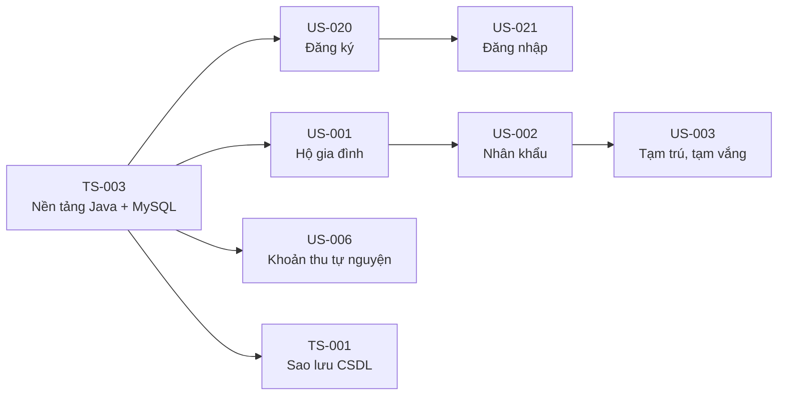

# Sprint Planning 1

- **Thời gian:** 16/11/2026 · **Hình thức:** thống nhất qua nhóm chat
- **Thành phần:** Đoàn Quốc Khánh (TV1, Scrum Master), Nguyễn Đình Dũng
  (TV2), Đinh Phi Hùng (TV3), Cao Thành Đạt (TV4), Vũ Nhật Huy (TV5)
- **Vắng:** không
- **Thư ký:** Đoàn Quốc Khánh

## 1. Chương trình họp

| # | Nội dung | Thời lượng | Kết quả cần có |
|---|---|---|---|
| 1 | Xác nhận giả định trong [11-chot-va-gia-dinh.md](../requirements/11-chot-va-gia-dinh.md) | 25 phút | Danh sách giả định giữ / sửa / bỏ |
| 2 | Thống nhất thời gian 4 Sprint | 5 phút | Ngày bắt đầu, kết thúc từng Sprint |
| 3 | Ước lượng lại Story Point bằng Planning Poker | 25 phút | SP chốt cho các story của Sprint 1 (và Sprint 2 nếu kịp) |
| 4 | Chọn story và Sprint Goal cho Sprint 1 | 10 phút | Sprint Backlog, Sprint Goal |
| 5 | Gán Issue và người review | 10 phút | Mỗi Issue Sprint 1 có người phụ trách, người review |
| 6 | Việc khác, chốt lịch họp | 5 phút | Lịch Daily, Sprint Review, Retrospective |

### 1.1. Giả định cần cả nhóm xác nhận

Toàn bộ giả định 1–46 trong tệp 11 đang ở trạng thái **cần cả nhóm xác
nhận**. Giả định 47–49 về các trường dữ liệu bổ sung (tùy chọn hóa trường
nhân khẩu, dân tộc và tôn giáo là dữ liệu nhạy cảm, nơi đến khi tạm vắng và
người nộp trên phiếu thu) đang chờ duyệt, xác nhận cùng lúc khi đã vào
`main`. Ưu tiên bàn trước các mục dưới đây vì chúng ảnh hưởng Sprint 1 hoặc
**làm chặt hơn Acceptance Criteria**:

| Giả định | Nội dung tóm tắt | Liên quan | Lý do cần bàn |
|---|---|---|---|
| 2 | Chỉ Quản trị viên tạo tài khoản; hai vai trò Quản trị viên, Thủ quỹ | US-020 | Khác cách hiểu "đăng ký" thông thường |
| 5 | Từ đủ 14 tuổi bắt buộc có số CCCD | US-002 | Quy tắc mới, AC chưa nêu |
| 6 | Trùng CCCD bị **chặn hẳn** (AC-008 chỉ ghi "cảnh báo") | US-002 | Chặt hơn AC |
| 7, 26 | Nhân khẩu không bị xóa; đổi chủ hộ là story riêng | US-002, US-026 | Ảnh hưởng thao tác "xóa" |
| 8–13 | Người tạm trú là nhân khẩu; đợt có hạn, không chồng ngày; trạng thái tính theo ngày | US-003 | Quyết định cách ghi tạm trú/tạm vắng |
| 14 | Đơn giá ngoài khoảng bị **chặn hẳn** (AC-017 chỉ ghi "cảnh báo") | US-005 | Chặt hơn AC |
| 17, 18 | Phân quyền hai lớp; luôn còn ít nhất một Quản trị viên | US-022 | Ảnh hưởng thiết kế đăng nhập |
| 28 | Thủ quỹ chỉ hủy phiếu do mình lập | US-014 | Quy tắc mới |
| 38 | Giờ lấy theo máy chủ dữ liệu, không theo máy thu ngân | US-012, US-014 | Ràng buộc kỹ thuật cho nhiều story |

Ghi kết quả vào bảng "Quyết định" (mục 5); giả định bị sửa hoặc bỏ thì cập
nhật tệp 11 trong một Pull Request riêng.

## 2. Thời gian 4 Sprint và tuần chốt

Mỗi Sprint 1 tuần, thêm 1 tuần chốt. Dự án kết thúc sau 5 tuần, tính từ
16/11/2026.

| Vòng | Từ ngày | Đến ngày | SP | Mốc |
|---|---|---|---|---|
| Sprint 1 | Thứ Hai 16/11/2026 | Chủ nhật 22/11/2026 | 32 | Phát hành `v0.1.0` |
| Sprint 2 | Thứ Hai 23/11/2026 | Chủ nhật 29/11/2026 | 31 | `v0.2.0` |
| Sprint 3 | Thứ Hai 30/11/2026 | Chủ nhật 06/12/2026 | 25 | `v0.3.0`, UAT lần 1 |
| Sprint 4 | Thứ Hai 07/12/2026 | Chủ nhật 13/12/2026 | 24 | `v0.4.0` |
| Tuần chốt | Thứ Hai 14/12/2026 | Chủ nhật 20/12/2026 | 0 (không nhận story mới) | Sửa lỗi UAT, UAT lần 2, phát hành `v1.0.0`, tài liệu nộp |

Sprint Review, Retrospective và Sprint Planning của vòng sau gộp một buổi
khoảng 1,5 giờ vào Chủ nhật cuối mỗi Sprint.

## 3. Sprint 1

### 3.1. Story của Sprint 1

Chọn theo hai tiêu chí: ưu tiên **Must** trong
[08-product-backlog.md](../requirements/08-product-backlog.md) và **phụ
thuộc** ghi trong [07-user-stories.md](../requirements/07-user-stories.md):
story nào nhiều story khác cần đến thì làm trước. Thêm US-006 và TS-001
(chỉ cần nền tảng TS-003) để TV3 và TV5 có story ngay từ Sprint 1.

| ID | Mô tả ngắn | Ưu tiên | SP (ước lượng ban đầu) | Phụ thuộc |
|---|---|---|---|---|
| TS-003 | Ứng dụng Java máy tính để bàn kết nối CSDL MySQL tập trung | Must | 5 | (không) |
| US-020 | Đăng ký tài khoản đăng nhập | Must | 3 | TS-003 |
| US-021 | Đăng nhập bằng tên đăng nhập và mật khẩu | Must | 3 | US-020 |
| US-001 | Thêm hộ gia đình và diện tích căn hộ | Must | 3 | TS-003 |
| US-002 | Thông tin nhân khẩu và quan hệ với chủ hộ | Must | 5 | US-001 |
| US-003 | Tạm trú, tạm vắng kèm ngày bắt đầu và kết thúc | Must | 5 | US-002 |
| US-006 | Tạo khoản thu tự nguyện theo từng đợt | Must | 3 | Không phụ thuộc story khác, chỉ cần nền tảng TS-003 |
| TS-001 | Sao lưu dữ liệu MySQL định kỳ | Should | 5 | TS-003 (chỉ cần CSDL MySQL) |
| **Tổng** | | | **32 SP** | |

### 3.2. Chuỗi phụ thuộc

- **TS-003 phải xong sớm, trong 1–2 ngày đầu Sprint 1:** cả bốn nhánh
  (tài khoản, hộ khẩu, khoản thu, sao lưu) đều bắt đầu từ nó, và theo backlog thì hầu hết các
  story còn lại đều phụ thuộc trực tiếp hoặc gián tiếp vào TS-003.
- Nhánh hộ khẩu là chuỗi dài nhất (US-001 → US-002 → US-003, 13 SP), nên
  bắt đầu US-001 ngay khi TS-003 có kết nối CSDL chạy được.
- TS-001 chỉ cần CSDL MySQL đã dựng theo `database/schema.sql`, nên TV5
  bắt đầu được song song với TS-003.
- US-022 (phân quyền) và US-023 (quản lý tài khoản) phụ thuộc US-021, để
  Sprint 2.

### 3.3. Sprint Goal

> Người dùng có tài khoản đăng nhập được vào ứng dụng, quản lý được hộ gia
> đình, nhân khẩu và tạm trú/tạm vắng, tạo được khoản thu tự nguyện và có
> bản sao lưu CSDL định kỳ; dữ liệu lưu trên MySQL.

## 4. Phân công và kế hoạch 4 Sprint

Theo milestone và người phụ trách đã đặt trên GitHub Issue. Mỗi người nhận
**trọn story** của một mảng để chỉ một người sửa một phần mã; vẫn có thể
cân lại trong họp theo năng lực và thời gian của từng người.

### 4.1. Phân công theo người

| Thành viên | Mảng | Story | Tổng SP |
|---|---|---|---|
| TV1 Khánh | Nền tảng, tài khoản; duyệt Pull Request | TS-003, US-020, US-021, US-022, US-023 | 19 |
| TV2 Dũng | Hộ gia đình, nhân khẩu; rà soát giao diện | US-001, US-002, US-003, US-026, US-027, TS-004 | 23 |
| TV3 Hùng | Danh mục khoản thu, công nợ, thông báo phí | US-005, US-006, US-008, US-009, US-015 | 19 |
| TV4 Đạt | Đóng góp và thu phí; thiết kế Figma | US-007, US-010, US-011, US-012, US-013, US-014 | 22 + thiết kế Figma (#70) |
| TV5 Huy | Báo cáo, thống kê; sao lưu, nhật ký | US-004, US-016, US-017, US-018, US-019, TS-001, TS-002 | 29 |
| **Tổng** | | | **112** |

Không gồm US-024, US-025 (v2.0). Issue của TV3 và TV4 chưa gán người được
trên GitHub vì hai bạn chưa là collaborator của repo; gán sau khi hai bạn
nhận lời mời.

### 4.2. Kế hoạch 4 Sprint (theo milestone)

| Sprint | Story (người phụ trách) | SP |
|---|---|---|
| Sprint 1 | TS-003, US-020, US-021 (TV1); US-001, US-002, US-003 (TV2); US-006 (TV3); TS-001 (TV5); thiết kế Figma cho các story Sprint 1–2 (TV4, #70) | 32 |
| Sprint 2 | US-022, US-023 (TV1); US-026, US-027 (TV2); US-005, US-009 (TV3); TS-002 (TV5); thiết kế Figma cho các story Sprint 3–4 (TV4, không tính SP) | 31 |
| Sprint 3 | US-008, US-015 (TV3); US-010, US-011, US-012, US-007 (TV4); US-004 (TV5) | 25 |
| Sprint 4 | TS-004 (TV2); US-013, US-014 (TV4); US-016, US-017, US-018, US-019 (TV5) | 24 |
| **Tổng** | | **112** |

SP từng người theo Sprint:

| Thành viên | Sprint 1 | Sprint 2 | Sprint 3 | Sprint 4 | Tổng |
|---|---|---|---|---|---|
| TV1 Khánh | 11 | 8 | 0 | 0 | 19 |
| TV2 Dũng | 13 | 8 | 0 | 2 | 23 |
| TV3 Hùng | 3 | 10 | 6 | 0 | 19 |
| TV4 Đạt | 0 | 0 | 16 | 6 | 22 |
| TV5 Huy | 5 | 5 | 3 | 16 | 29 |

TV4 Đạt ở Sprint 1–2 không nhận story mà làm thiết kế Figma (#70): màn hình cho các story Sprint 1–2 trong Sprint 1 (trước 22/11), cho Sprint 3 trước 26/11 và Sprint 4 trước 29/11. US-007 chuyển sang Sprint 3, làm sau US-011 vì cần phiếu thu.

- **Sprint 4 nặng nhất với TV5 (16 SP).** Nếu không kịp thì bỏ trước
  **US-018** (xuất báo cáo Excel, ưu tiên Could, 5 SP), giữ các story
  Should.
- TV1 trống story ở Sprint 3–4 để dành thời gian duyệt Pull Request và hỗ
  trợ các mảng còn nhiều việc.
- Mọi người vẫn review Pull Request chéo cho nhau.
- TS-004 (rà giao diện) làm ở cuối Sprint 4, sau khi mọi màn hình đã
  merge. Tuần chốt 14/12 – 20/12 không nhận story mới, chỉ để sửa lỗi,
  UAT lần 2, phát hành `v1.0.0` và nộp bài.

## 5. Quyết định

| # | Nội dung quyết định | Ghi chú |
|---|---|---|
| 1 | Mỗi Sprint 1 tuần, 4 Sprint và 1 tuần chốt: Sprint 1 16/11–22/11, Sprint 2 23/11–29/11, Sprint 3 30/11–06/12, Sprint 4 07/12–13/12, tuần chốt 14/12–20/12 | Mục 2 |
| 2 | Sprint 1 gồm TS-003, US-020, US-021 (TV1); US-001, US-002, US-003 (TV2); US-006 (TV3); TS-001 (TV5); TV4 thiết kế Figma (#70). Tổng 32 SP | Sprint Goal như mục 3.3 |
| 3 | Phân công và kế hoạch 4 Sprint theo mục 4, khớp milestone và Issue trên GitHub | Người review theo Issue kế hoạch #72–#74 |
| 4 | Nếu US-003 không kịp 22/11 thì chuyển sang Sprint 2; nếu Sprint 4 không kịp thì bỏ US-018 (Could) trước | |
| 5 | Bố cục giao diện: menu trái (trái – đầu – thân), màu phương án A | Chỉnh theo Figma (#70); xem [ui.md](../design/ui.md) |
| 6 | Daily mỗi tối 21:00 qua nhóm chat; Sprint Review, Retrospective và Sprint Planning gộp một buổi vào Chủ nhật cuối mỗi Sprint | |
| 7 | Các giả định trong [11-chot-va-gia-dinh.md](../requirements/11-chot-va-gia-dinh.md) (gồm 47–49) chưa xác nhận | Bàn ở buổi họp 22/11 |

## 6. Việc cần làm

| # | Việc | Người phụ trách | Hạn |
|---|---|---|---|
| 1 | Dựng môi trường theo [setup.md](../setup.md), đọc [kien-truc.md](../design/kien-truc.md) | Cả nhóm | 17/11 |
| 2 | Mời TV3 Hùng làm collaborator, gán Issue #13, #14, #16, #17, #23 | TV1 | 17/11 |
| 3 | Làm Issue Sprint 1 của mình theo bảng giao việc | Mỗi người | 22/11 |
| 4 | Màn hình Figma cho Sprint 1 và Sprint 2 | TV4 | Sprint 1: 18/11; Sprint 2: 22/11 |
| 5 | Chuẩn bị buổi Sprint Review và Sprint Planning 2 | TV1 | 22/11 |
