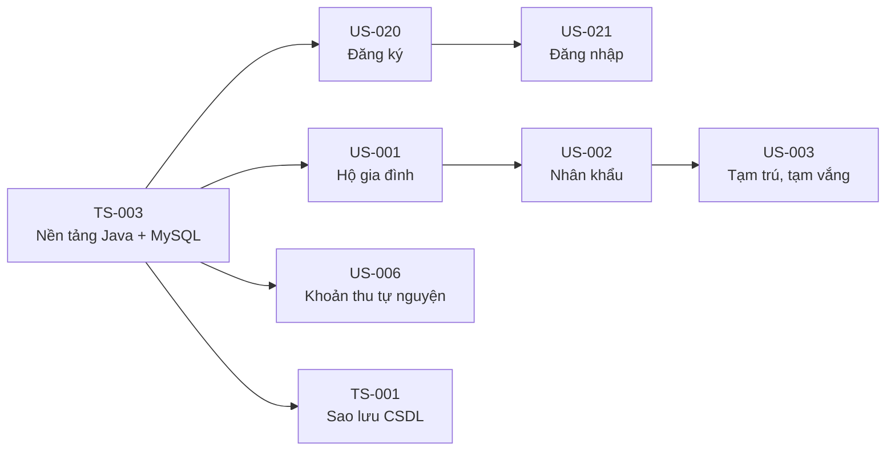

# Sprint Planning 1 (dự thảo)

> **Dự thảo** do Scrum Master chuẩn bị trước buổi họp. Mọi đề xuất bên dưới
> để cả nhóm sửa trong họp; sau họp ghi kết quả vào các bảng "Quyết định" và
> "Việc cần làm". Nếu họp khác ngày 16/11/2026 thì đổi ngày trong tên tệp.

- **Thời gian:** ……… · **Hình thức:** ………
- **Thành phần:** Đoàn Quốc Khánh (TV1, Scrum Master), Nguyễn Đình Dũng
  (TV2), Đinh Phi Hùng (TV3), Cao Thành Đạt (TV4), Vũ Nhật Huy (TV5)
- **Vắng:** ………
- **Thư ký:** ………

## 1. Chương trình họp

| # | Nội dung | Thời lượng | Kết quả cần có |
|---|---|---|---|
| 1 | Xác nhận giả định trong [11-chot-va-gia-dinh.md](../requirements/11-chot-va-gia-dinh.md) | 25 phút | Danh sách giả định giữ / sửa / bỏ |
| 2 | Thống nhất thời gian 4 Sprint | 5 phút | Ngày bắt đầu, kết thúc từng Sprint |
| 3 | Ước lượng lại Story Point bằng Planning Poker | 25 phút | SP chốt cho các story của Sprint 1 (và Sprint 2 nếu kịp) |
| 4 | Chọn story và Sprint Goal cho Sprint 1 | 10 phút | Sprint Backlog, Sprint Goal |
| 5 | Gán Issue và người review | 10 phút | Mỗi Issue Sprint 1 có người phụ trách, người review |
| 6 | Việc khác, chốt lịch họp | 5 phút | Lịch Daily, Sprint Review, Retrospective |

### 1.1. Giả định cần cả nhóm xác nhận

Toàn bộ giả định 1–46 trong tệp 11 đang ở trạng thái **cần cả nhóm xác
nhận**. Giả định 47–49 về các trường dữ liệu bổ sung (tùy chọn hóa trường
nhân khẩu, dân tộc và tôn giáo là dữ liệu nhạy cảm, nơi đến khi tạm vắng và
người nộp trên phiếu thu) đang chờ duyệt, xác nhận cùng lúc khi đã vào
`main`. Ưu tiên bàn trước các mục dưới đây vì chúng ảnh hưởng Sprint 1 hoặc
**làm chặt hơn Acceptance Criteria**:

| Giả định | Nội dung tóm tắt | Liên quan | Lý do cần bàn |
|---|---|---|---|
| 2 | Chỉ Quản trị viên tạo tài khoản; hai vai trò Quản trị viên, Thủ quỹ | US-020 | Khác cách hiểu "đăng ký" thông thường |
| 5 | Từ đủ 14 tuổi bắt buộc có số CCCD | US-002 | Quy tắc mới, AC chưa nêu |
| 6 | Trùng CCCD bị **chặn hẳn** (AC-008 chỉ ghi "cảnh báo") | US-002 | Chặt hơn AC |
| 7, 26 | Nhân khẩu không bị xóa; đổi chủ hộ là story riêng | US-002, US-026 | Ảnh hưởng thao tác "xóa" |
| 8–13 | Người tạm trú là nhân khẩu; đợt có hạn, không chồng ngày; trạng thái tính theo ngày | US-003 | Quyết định cách ghi tạm trú/tạm vắng |
| 14 | Đơn giá ngoài khoảng bị **chặn hẳn** (AC-017 chỉ ghi "cảnh báo") | US-005 | Chặt hơn AC |
| 17, 18 | Phân quyền hai lớp; luôn còn ít nhất một Quản trị viên | US-022 | Ảnh hưởng thiết kế đăng nhập |
| 28 | Thủ quỹ chỉ hủy phiếu do mình lập | US-014 | Quy tắc mới |
| 38 | Giờ lấy theo máy chủ dữ liệu, không theo máy thu ngân | US-012, US-014 | Ràng buộc kỹ thuật cho nhiều story |

Ghi kết quả vào bảng "Quyết định" (mục 5); giả định bị sửa hoặc bỏ thì cập
nhật tệp 11 trong một Pull Request riêng.

## 2. Thời gian 4 Sprint (đề xuất)

Mỗi Sprint 2 tuần, theo [workflow.md](../workflow.md).

| Sprint | Từ ngày | Đến ngày | Mốc |
|---|---|---|---|
| Sprint 1 | 16/11/2026 | 29/11/2026 | Phát hành `v0.1.0` |
| Sprint 2 | 30/11/2026 | 13/12/2026 | `v0.2.0` |
| Sprint 3 | 14/12/2026 | 27/12/2026 | `v0.3.0`, UAT lần 1 |
| Sprint 4 | 28/12/2026 | 10/01/2027 | `v1.0.0`, UAT lần 2 |

Cần đối chiếu với lịch nộp bài của môn trước khi chốt.

## 3. Đề xuất Sprint 1

### 3.1. Story đề xuất

Chọn theo hai tiêu chí: ưu tiên **Must** trong
[08-product-backlog.md](../requirements/08-product-backlog.md) và **phụ
thuộc** ghi trong [07-user-stories.md](../requirements/07-user-stories.md):
story nào nhiều story khác cần đến thì làm trước. Thêm US-006 và TS-001
(chỉ cần nền tảng TS-003) để TV3 và TV5 có story ngay từ Sprint 1.

| ID | Mô tả ngắn | Ưu tiên | SP (ước lượng ban đầu) | Phụ thuộc |
|---|---|---|---|---|
| TS-003 | Ứng dụng Java máy tính để bàn kết nối CSDL MySQL tập trung | Must | 5 | (không) |
| US-020 | Đăng ký tài khoản đăng nhập | Must | 3 | TS-003 |
| US-021 | Đăng nhập bằng tên đăng nhập và mật khẩu | Must | 3 | US-020 |
| US-001 | Thêm hộ gia đình và diện tích căn hộ | Must | 3 | TS-003 |
| US-002 | Thông tin nhân khẩu và quan hệ với chủ hộ | Must | 5 | US-001 |
| US-003 | Tạm trú, tạm vắng kèm ngày bắt đầu và kết thúc | Must | 5 | US-002 |
| US-006 | Tạo khoản thu tự nguyện theo từng đợt | Must | 3 | Không phụ thuộc story khác, chỉ cần nền tảng TS-003 |
| TS-001 | Sao lưu dữ liệu MySQL định kỳ | Should | 5 | TS-003 (chỉ cần CSDL MySQL) |
| **Tổng** | | | **32 SP** | |

### 3.2. Chuỗi phụ thuộc

- **TS-003 phải xong sớm, trong 2–3 ngày đầu Sprint:** cả bốn nhánh
  (tài khoản, hộ khẩu, khoản thu, sao lưu) đều bắt đầu từ nó, và theo backlog thì hầu hết các
  story còn lại đều phụ thuộc trực tiếp hoặc gián tiếp vào TS-003.
- Nhánh hộ khẩu là chuỗi dài nhất (US-001 → US-002 → US-003, 13 SP), nên
  bắt đầu US-001 ngay khi TS-003 có kết nối CSDL chạy được.
- TS-001 chỉ cần CSDL MySQL đã dựng theo `database/schema.sql`, nên TV5
  bắt đầu được song song với TS-003.
- US-022 (phân quyền) và US-023 (quản lý tài khoản) phụ thuộc US-021, để
  Sprint 2.

### 3.3. Sprint Goal (đề xuất)

> Người dùng có tài khoản đăng nhập được vào ứng dụng, quản lý được hộ gia
> đình, nhân khẩu và tạm trú/tạm vắng, tạo được khoản thu tự nguyện và có
> bản sao lưu CSDL định kỳ; dữ liệu lưu trên MySQL.

## 4. Đề xuất phân công theo mảng

Mỗi người nhận **trọn story** của một mảng, để chỉ một người sửa một phần
mã; cân lại trong họp theo năng lực và thời gian của từng người.

| Thành viên | Mảng | Story | Tổng SP |
|---|---|---|---|
| TV1 Khánh | Nền tảng, tài khoản; duyệt Pull Request | TS-003, US-020, US-021, US-022, US-023 | 19 |
| TV2 Dũng | Hộ gia đình, nhân khẩu | US-001, US-002, US-003, US-004, US-026, US-027 | 24 |
| TV3 Hùng | Danh mục và khoản thu | US-005, US-006, US-007, US-008, US-009 | 21 |
| TV4 Đạt | Thu phí và thanh toán | US-010, US-011, US-012, US-013, US-014, US-015 | 20 |
| TV5 Huy | Thống kê, báo cáo; sao lưu, nhật ký | US-016, US-017, US-018, US-019, TS-001, TS-002 | 26 |
| Cả nhóm | Rà soát giao diện | TS-004 | 2 |

Tổng 112 SP (không gồm US-024, US-025 của v2.0).

**Trong Sprint 1:**

| Thành viên | Việc | SP |
|---|---|---|
| TV1 Khánh | TS-003, US-020, US-021 | 11 |
| TV2 Dũng | US-001, US-002, US-003 | 13 |
| TV3 Hùng | US-006 | 3 |
| TV4 Đạt | Thiết kế màn hình trên Figma: chọn bố cục, bảng phối màu và vẽ màn hình cho các story Sprint 1–2, để các bạn dựng giao diện theo | – |
| TV5 Huy | TS-001 | 5 |

Mọi người vẫn review Pull Request chéo cho nhau.

## 5. Quyết định

| # | Nội dung quyết định | Ghi chú |
|---|---|---|
| 1 | | |
| 2 | | |
| 3 | | |
| 4 | | |
| 5 | | |

## 6. Việc cần làm

| # | Việc | Người phụ trách | Hạn |
|---|---|---|---|
| 1 | | | |
| 2 | | | |
| 3 | | | |
| 4 | | | |
| 5 | | | |
